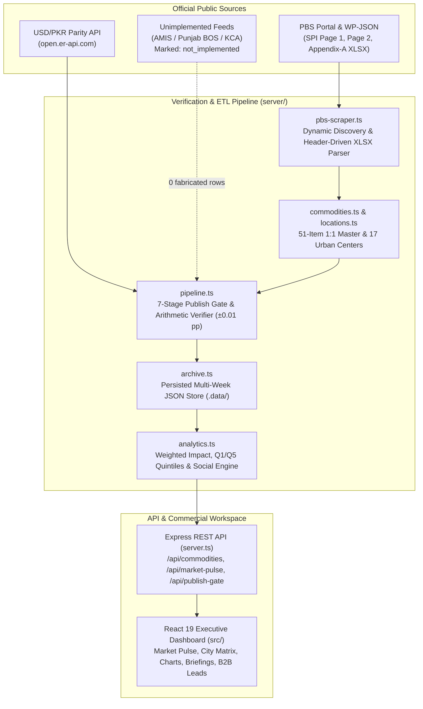

<div align="center">

## Pakistan Market Intelligence Engine

### Sovereign-Grade Essential Commodity Analytics, Verification Pipeline & Executive Briefing Platform

[](https://www.typescriptlang.org/)
[](https://react.dev/)
[](https://nodejs.org/)
[](https://tailwindcss.com/)
[](#integrity-validation-suite)
[](#7-stage-publish-gate)

**Automated ingestion, mathematical auditing, econometric decomposition, and executive market publishing across all 51 Pakistan Bureau of Statistics (PBS) SPI commodities and 17 urban centers.**

[Architecture](#-system-architecture) • [Pipeline Intelligence](#-core-pipeline--verification-intelligence) • [Publish Gate](#-7-stage-publish-gate) • [API Reference](#-rest-api-reference) • [Quick Start](#-quick-start--deployment)

</div>

---

## 🎯 Executive Overview

Commodity intelligence platforms routinely fail institutional buyers, economists, and supply-chain analysts in three ways:
1. **Silent Synthetic Fallbacks** — fabricating prices, random-walk histories, or circular "cross-validation" scores when upstream portals change layout or time out.
2. **Partial-Basket Illusion** — presenting top movers as total market direction or misinterpreting unweighted item counts against expenditure-weighted inflation indices.
3. **Brittle Position-Based Scraping** — hardcoding Excel columns that silently misalign cities, corrupt units, or attribute non-perishable grade differences to regional arbitrage.

**Pakistan Market Intelligence** eliminates every one of those failure modes with a deterministic, **zero-fabrication ETL and verification engine**. Every number surfaced in the dashboard, historical time-series, REST API, and exportable executive briefing is traced directly to live-discovered official **Pakistan Bureau of Statistics (PBS)** Sensitive Price Indicator (SPI) Excel workbooks (`Page 1`, `Page 2`, and `Appendix-A`) and live **USD/PKR** parity feeds—protected by a **7-point automated Publish Gate**.

---

## ✨ Core Pipeline & Verification Intelligence

### 1. Dynamic Release Discovery & Multi-Sheet Excel Ingestion (`server/pbs-scraper.ts`)
- **Autonomous Portal & WP-JSON Discovery:** Crawls `pbs.gov.pk` Price Statistics listings and WordPress REST feeds to automatically detect the latest Thursday SPI release as well as historical weekly bulletins—eliminating stale hardcoded URLs.
- **Header-Driven Dynamic Parsing:** Zero fixed column-index assumptions. The `PbsHeaderExcelParser` inspects live sheet headers across:
  - **Page 1 (Macro & Quintiles):** Combined SPI index, Week-over-Week (`WoW%`), Year-over-Year (`YoY%`), and full **Q1–Q5** expenditure quintile trajectories.
  - **Page 2 (51-Item National Basket):** Exact commodity names, official PBS units, current/previous/year-ago national prices, official `%` changes, expenditure weights (`weight_lowest_pct`, `weight_combined_pct`), and percentage-point index impacts (`impact_lowest_pp`, `impact_combined_pp`).
  - **Appendix-A (17-City Matrix):** Dynamically resolves all **17 urban centers** across Punjab, Sindh, KPK, Balochistan, and Federal territory (`17 × 51 = 867` city-item cells), stripping footnote markers (e.g., `Electricity Charges for Q1*`) so zero valid observations are dropped.

### 2. 1:1 Canonical Master & Collision-Free Normalization (`server/commodities.ts`, `server/locations.ts`)
- **Strict 51-Commodity Alignment:** 1:1 canonical catalog matching every official PBS SPI basket item (`COMMODITY_MASTER`) with zero duplicate IDs and zero fuzzy substring leaks (e.g., strictly isolating `Gur (Average Quality)` from `Sugar Refined`, and `Petrol Super` from `Hi-Speed Diesel`).
- **Standardized Clean Unit Formatting:** Preserves exact official PBS specifications (such as `LPG 11.67 kg Cylinder`) while cleanly formatting human-facing unit labels (`1 Kg → kg`, `1 Dozen → dozen`, `1 Ltr → litre`, `Each → unit`, `20 Kg → 20 kg bag`).
- **Complete 17-City Urban Coverage:** Tracks Islamabad, Rawalpindi, Gujranwala, Sialkot, Lahore, Faisalabad, Sargodha, Multan, Bahawalpur, Karachi, Hyderabad, Sukkur, Larkana, Peshawar, Bannu, Quetta, and Khuzdar with coordinates, provincial taxonomy, and primary wholesale/retail market metadata.

### 3. Econometric Decomposition & Outlier Protection (`server/analytics.ts`)
- **Unweighted Breadth vs. Weighted SPI Explainer:** Automatically detects divergence between raw advancer/decliner counts and the expenditure-weighted Combined SPI index—ranking the exact Page 2 negative-impact drivers (`impact_combined_pp <= -0.01`) that outweighed smaller price increases.
- **Income-Quintile Distributional Analytics:** Surfaces week-over-week inflation divergence between the lowest expenditure bracket (**Q1**, up to Rs 17,732) and the highest bracket (**Q5**, above Rs 44,175).
- **Food & Energy Spread Guardrail:** Restricts inter-city arbitrage/spread spotlights strictly to **Food & Energy** categories (`Vegetables & Fruits`, `Grains & Staples`, `Cooking Oils`, `Meat, Poultry & Dairy`, `Sugar & Spices`, `Fuel & Energy`), automatically flagging `>40%` dispersion in non-perishable apparel/household items (such as `Shirting`) as regional quality/grade variance rather than market arbitrage.
- **Explicit Rule-Based Market Direction:** Replaces subjective financial jargon with deterministic `≥50%` majority classification (`Broad-Based Increase`, `Broad-Based Decrease`, `Predominantly Stable`, or `Mixed`), exposing the exact threshold rule in every payload.

### 4. Real Historical Archive & Honest Source Registry (`server/archive.ts`, `server/registry.ts`)
- **Zero Synthetic History:** Builds multi-week national and city-level price series exclusively from archived official PBS weekly workbooks and `Appendix-A` matrices persisted in `.data/market-archive.json` (auto-backfilling up to 20 historical releases).
- **Zero Circular "Cross-Validation":** Actively executes verified feeds (`PBS_SPI`, `SBP_FOREX` USD/PKR parity) while transparently flagging unimplemented or unreachable provincial scrapers (`AMIS`, `PUNJAB_BOS`, `KCA`) as `not_implemented` with `0` fabricated observations.

---

## 🛡 7-Stage Publish Gate

Before the engine authorizes a Market Pulse report or unlocks social/executive export, `evaluatePublishGate()` executes seven strict automated checks. If any critical check fails, the system fails loudly and blocks automated export:

| # | Gate Check | Verification Rule |
|---|---|---|
| **1** | **51-Item Basket Completeness** | Confirms exact `51 / 51` PBS SPI commodities parsed from Page 2. |
| **2** | **1:1 Canonical Item Mapping** | Verifies all 51 items map uniquely (`0` unmapped items, `0` ID collisions). |
| **3** | **Release Freshness Window** | Enforces `≤ 8` calendar days for live releases, or labels historical fallbacks explicitly as `"Latest Available PBS Release"`. |
| **4** | **Headline Macro Metrics** | Validates finite Combined SPI index, `WoW%`, and `YoY%` values from Page 1. |
| **5** | **Strict Arithmetic Check (`±0.01 pp`)** | Recomputes `(Current - Previous) / Previous × 100` across all 51 rows and asserts `0` discrepancies beyond `±0.01 pp`. |
| **6** | **Header-Verified 17-City Matrix** | Confirms all 17 city columns in `Appendix-A` and tracks exact non-empty cell coverage (e.g., `864 / 867` observations). |
| **7** | **Live Release URL Verification** | Executes live HTTP resolution (`HEAD` with `GET` fallback) on the PBS bulletin URL before embedding citations. |

---

## 🏗 System Architecture



---

## 💻 Commercial Workspace & UI Modules

Built with **React 19**, **Tailwind CSS v4**, **Recharts**, **Motion**, and **Lucide Icons**:

- **Market Pulse & Social Post Generator (`MarketPulseView.tsx`):** Real-time Publish Gate badge, full 51-item breadth breakdown, Weighted SPI vs. Breadth divergence card, Q1/Q5 distributional impact panel, Food & Energy regional spread spotlight, and one-click verified LinkedIn/executive briefing copy.
- **Interactive Commodity Analytics (`Analysis.tsx`, `CommodityCard.tsx`, `CommodityDetail.tsx`):** Filter across all 51 SPI commodities and 17 cities, inspect real archived national vs. city-level historical price curves, and audit official weights and `WoW%` arithmetic.
- **17-City Price Matrix (`CityComparisonView.tsx`):** Side-by-side spatial pricing comparison across all 17 PBS urban hubs with min/max regional spreads.
- **Executive Printable Reports (`MarketReport.tsx`, `AnalysisReport.tsx`):** Structured institutional reports covering macro SPI indicators, top risers/decliners, and provincial dispersion.
- **Data Registry, Logs & Pipeline Control (`Settings.tsx`):** Inspect live source statuses, trigger manual backfill/refresh runs, view stage-by-stage pipeline execution logs, and toggle active monitoring hubs.
- **Commercial B2B Inquiry Capture (`BusinessInquiryModal.tsx`):** Enterprise lead intake for Bulk Historical Data, Procurement API Feeds, ERP Integration, and Custom Mandi Coverage.

---

## 🔌 REST API Reference

| Method | Endpoint | Description |
|---|---|---|
| `GET` | `/api/market-pulse` | Full Publish-Gate-checked Market Pulse, breadth, weighting note, Q1/Q5 insight, Food & Energy spreads, and ready-to-publish briefing (`?date=YYYY-MM-DD` optional). |
| `GET` | `/api/commodities` | Complete 51-item canonical commodity list with national or city-filtered pricing (`?city=Lahore`). |
| `GET` | `/api/commodities/:id` | Detailed commodity record, regional verification status, and national historical series. |
| `GET` | `/api/history/:id` | Real archived weekly time-series for a commodity (`?city=All` or specific city name). |
| `GET` | `/api/publish-gate` | Current 7-stage Publish Gate diagnostics, archive statistics, and latest USD/PKR snapshot. |
| `GET` | `/api/archive/weeks` | Metadata index of all persisted official PBS SPI weekly releases. |
| `GET` | `/api/cities` / `PUT /api/cities/:id` | Lists all 17 PBS urban centers or toggles monitoring state. |
| `GET` | `/api/sources` / `POST` / `PUT` / `DELETE` | Inspects or manages the data source registry (custom sources default safely to `not_implemented`). |
| `GET` | `/api/cross-validations` | Item-level source verification and 17-city coverage matrix. |
| `POST` | `/api/pipeline/run` | Executes live PBS discovery, Excel parsing, backfill archive sync, and Publish Gate evaluation. |
| `GET` | `/api/logs` | Stage-tagged (`DISCOVER`, `INGEST`, `PARSE`, `ARCHIVE`, `VALIDATE`, `PUBLISH`) pipeline audit logs. |
| `POST` / `GET` | `/api/enterprise/inquiry` | Captures and lists commercial enterprise data-feed inquiries. |

---

## 📁 Repository Structure

```text
├── server.ts                  # Express server, Vite dev middleware, REST API & B2B inquiry endpoints
├── desktop-launcher.js        # Zero-config production launcher (auto-builds & opens local browser)
├── server/
│   ├── pbs-scraper.ts         # Dynamic PBS release discovery, HTTP verification & header-driven XLSX parser
│   ├── commodities.ts         # 51-item 1:1 canonical master, exact lookup & unit formatter
│   ├── locations.ts           # 17 official PBS urban centers with market & provincial metadata
│   ├── pipeline.ts            # DataEngine orchestrator & 7-stage evaluatePublishGate()
│   ├── analytics.ts           # Market breadth, weighted driver notes, Q1/Q5 quintiles & post generator
│   ├── archive.ts             # Persistent JSON multi-week archive manager (.data/market-archive.json)
│   └── registry.ts            # Honest source registry (PBS_SPI, SBP_FOREX, explicit not_implemented feeds)
├── scripts/
│   └── validate-local.ts      # 28-assertion end-to-end integrity & live scraping verification suite
└── src/
    ├── App.tsx                # Workspace shell, navigation, pipeline triggers & enterprise modals
    ├── types.ts               # Shared TypeScript contracts for Publish Gate, commodities & pulses
    └── components/            # MarketPulseView, Analysis, CityComparisonView, Reports & Settings
```

---

## 🚀 Quick Start & Deployment

### Prerequisites
- **Node.js** `>= 20.x`
- **npm** `>= 10.x`

### 1. Installation & Environment Setup
```bash
npm install
cp .env.example .env
```

Configure environment variables in `.env` as needed (only required if deploying behind custom URLs or enabling optional Gemini server-side capabilities):
- `APP_URL` — Public application origin for self-referential links.
- `GEMINI_API_KEY` — Optional server-side Gemini API key (configured via runtime secrets; never exposed in client bundles).

### 2. Development Mode
Runs the Express API and Vite SPA together on port `3000` and automatically triggers initial live PBS discovery & archive hydration:
```bash
npm run dev
```
Open `http://localhost:3000`.

### 3. Production Build & Start
Compiles the Vite React frontend (`dist/`) and bundles `server.ts` via `esbuild` into `dist/server.cjs`:
```bash
npm run build
npm start
```

### 4. Standalone Desktop Mode
Automatically compiles if needed, launches the production server, and opens the dashboard in your default browser:
```bash
npm run desktop
```
*(Windows and Unix convenience scripts are also included via `start-desktop.bat` and `start-desktop.sh`.)*

---

## 🧪 Integrity Validation Suite

Verify canonical mappings, live PBS discovery, Appendix-A matrix coverage, strict `±0.01 pp` arithmetic parity, honest registry isolation, and Publish Gate enforcement with a single command:

```bash
npm run validate
# or: npm run test:local
```

**What the 28-assertion suite verifies:**
- Exact `51`-item canonical master and `17`-city master integrity with zero collisions.
- Exact rejection of unsafe partial substring lookups (e.g., rejecting `"diesel"`, isolating `gur_jaggery` from `sugar_refined`).
- Live PBS release discovery, `17/17` header-verified `Appendix-A` parsing, and idempotent pipeline re-runs.
- Honest `not_implemented` isolation (`0` synthetic observations for `AMIS`, `PUNJAB_BOS`, and `KCA`).
- Food & Energy regional spread scoping (ensuring non-perishable `>40%` outliers like Shirting are excluded from Market Pulse spreads).
- Official `±0.01 pp` recomputed `WoW%` arithmetic verification and live HTTP URL check across all 51 items.

Also run full TypeScript type verification anytime via:
```bash
npm run lint
```

<div align="center">

**Built for institutional accuracy — where every published metric passes verification before it leaves the pipeline.**

</div>
